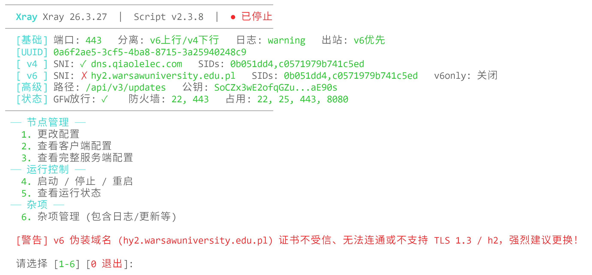

# XHTTP 双栈上下行分离一键安装管理脚本

本项目是一款专为双栈（IPv4/IPv6）回国路线优秀的服务器设计的 Xray 一键安装管理脚本。基于**VLESS-REALITY + XHTTP** 架构，支持 **IPv4/IPv6 上下行分流**来最大化伪装。（基于上游bash模板，大改了所有内容）



## 🚀 核心配置特点

1. 🌐 双栈上下行物理分离：上传流量和下载流量路由到服务器的两个不同 IP 栈（如：IPv4 上行，IPv6 下行），且不同栈拥有截然不同的伪装参数。

2. 🛡️ 顶配 XHTTP 伪装与混淆：设置了多项深度的 `xhttp` 高级混淆与性能优化参数：`x-padding-bytes`、`x-padding-placement`、`x-padding-method`、`x-padding-key`、`x-padding-header`、`x-padding-obfs-mode`、`session/seq-placement`、`no-grpc-header`、`no-sse-header`、`uplink-http-method`、`sc-stream-up-server-secs`、`server-max-header-bytes`、`max-concurrency`、`h-max-request-times`、`h-max-reusable-secs`，以及客户端侧的 `packet-encoding: xudp`、`tcp-fast-open` (TFO) 与 `tcp-mptcp` (MPTCP)。配合上行模拟 `chrome` 指纹，下行模拟 `firefox` 指纹。

3. 🔒 REALITY 安全性
    - Vision 流控：入站支持 `xtls-rprx-vision`
    - 端口回落：检测 443 端口被占用时，回落至 8443 端口，拒绝非标端口。

## 🛠️ 脚本功能大纲

- 自动加速优化：内核支持时启用 BBR；TFO 与 MPTCP 的效果取决于内核、网络和客户端。支持选择真正的 Happy Eyeballs 双栈 TCP 连接竞速（需 Xray v25.6.8+）；`UseIPv4v6` 仅表示解析优先，不等于连接失败回退。
- 双栈入口隔离：IPv4 绑定本机路由源地址，IPv6 设置 IPv6-only，避免两个同端口通配监听器争抢连接、进入错误的 REALITY SNI；已有脚本配置自动事务迁移。[实测与修复记录](docs/xhttp-delay-investigation-2026-10-17.md)。
- 安全探针：
  - 每次打开脚本连接上海移动、联通、电信目标的 TCP 80 端口，任意一个成功即国内可达；并行 ping Cloudflare `1.1.1.1` / `1.0.0.1`，ICMP 不通时尝试 TCP 443。区分国内异常、境外异常和国内外均不可达；结果不能证明国内客户端到本机是否被阻断。只读 JSON 检测入口：`bash /usr/local/etc/xray/sh/src/network_probe.sh --json`。
  - SNI 快速自检：一次 HTTPS HEAD 请求同时检查证书、TLS 1.3 与实际协商的 h2，单请求最多 3 秒；两个目标和 DNS 查询并行执行，返回菜单复用结果，域名变化自动刷新。本机 curl 不支持 HTTP/2 时明确提示 h2 未验证。
  - CDN 线索：复用该请求的 CDN 响应头，并检查 DNS 别名中的已知 CDN 域名；不额外串行查询 ASN API。DNS 查询失败报告无法判断，多地址解析不直接认定 CDN；未发现线索也不代表已证明目标无 CDN。
- 安全策略与分流：使用独立防火墙链，保留系统与其他应用规则；屏蔽 BitTorrent (BT) 下载、阻断回国流量与 Private IP 段。支持自定义分流规则管理（支持在阻断回国流量之前插入自定义规则，如放行 `geosite:cn` 内部的 `DOMAIN-SUFFIX,kimi.ai`）。
- 配置交互：
  - 支持更改端口（仅支持 443/8443）、路径、UUID、密钥对、各栈 SNI 伪装域名与 ShortIds。
  - 支持增加、编辑、删除与排序自定义分流规则（支持 `DOMAIN`、`DOMAIN-SUFFIX`、`DOMAIN-KEYWORD`、`IP-CIDR`、`GEOSITE`、`GEOIP`，动作支持放行 `direct`、IPv4 解析 `direct-v4`、IPv6 解析 `direct-v6` 与阻止 `block`）。
  - 支持一键切换双栈分离方向（v4上行/v6下行 或 v6上行/v4下行）。
  - 支持切换出站 IP 策略（IPv4 / IPv6 解析、双栈解析优先 / 双栈连接竞速），适配不同双栈或纯 IPv6 机器需求。
  - 支持选择 XHTTP 双栈分离、单栈 XHTTP 或 Vision Reality 客户端连接方案，输出对应的 Mihomo YAML 或 VLESS 分享链接。
- 🔗 线路 / 落地互联：支持将优质线路 VPS 与落地 VPS 互联，采用内部专用的 VLESS RAW + Vision + VLESS 加密传输。
  - **线路机**：`客户端 → 线路机 → 落地机 → Internet`；**一台线路机支持绑定多台落地机**，并为每台落地机设置备注别名与独立专属客户端 UUID，导出客户端配置时可自由选择出口落地。
  - **落地机**：支持独立普通节点模式，亦支持**纯落地机模式**（专为 NAT / LXC 容器设计，无需 XHTTP 与标准 443 端口，无防火墙权限时自动跳过 iptables 限制，支持自定义公网 IP 与内外网映射端口）。
  - **创建与导入**：先在落地机配置中继（或安装时直接选纯落地机模式），生成中继链接；再在线路机进入 `4. 线路 / 落地互联` 导入链接并设置备注。
  - **客户端导出**：在线路机进入 `2. 查看客户端配置`，选择对应落地出口；客户端连接地址仍为线路机。
- 运维支持：
  - 合并双端配置文件，提供服务端 JSON 配置预览。
  - 支持查看综合日志（混合输出 access.log 与 error.log）、修改日志等级、配置校验（与启动服务分开）。
  - 防火墙双栈端口管理（放行/关闭）、核心及脚本的在线升级（无 iptables 权限环境自动优雅降级，不阻断运行）。
  - 配置先校验再应用，失败自动回滚；更新校验下载内容并保留上一版本，内容未变化时不重启。脚本更新保留额外的用户文件与外部补丁模块。
  - geodata 每日通过 systemd 定时更新，校验失败保留旧数据；日志自动轮转，退出时清理临时文件与跟踪进程。
- 集中管理（可选）：通过 [Xray Panel](https://github.com/Chen017/Xray-Panel) 管理多台 VPS、下发配置并生成按设备授权的 age 加密 Mihomo 订阅；Panel / Agent v1.3.2 起复用本脚本的国内 / Cloudflare 自检，支持连续失败、恢复与 SNI 的 Telegram 告警，无需额外测点。

## ⚙️ 兼容性

- 支持系统：Ubuntu / Debian / CentOS（含无特权 LXC 容器与 NAT VPS）
- 架构：x86_64 / arm64
- Xray 版本：固定使用 [XTLS/Xray-core v26.3.27](https://github.com/XTLS/Xray-core/releases/tag/v26.3.27)，安装、重装和核心更新均遵循该版本；脚本与 geodata 可独立更新。
- Mihomo 客户端：跟随最新正式 Release；测试记录具体核心版本。仅在 Mihomo 明确支持其它 Xray 版本后重新评估服务端升级。

v2.7.9 修复 Short ID 字符串导出、含空格备注、分离方向切换、无来源限制的落地端口放行及故障转移顺序，并清理 VLESS 链接中的服务端专用字段。VLESS 链接的 Xray 下行独立参数仍保留，不能直接按 Mihomo 的字段限制删除。

v2.7.8 的版本策略与监听修复实测见 [验证记录](docs/newnb-validation-2026-10-17.md)。其中提供临时配置 A/B 工具，自动保留并恢复日常订阅的选择组，避免手工粘贴 YAML。

## ⚡ 快速开始

### 安装命令
```bash
bash <(wget -qO- -o- https://github.com/Chen017/Xray/raw/main/install.sh)
```
> **提示**：安装时支持选择 **标准节点** 或 **纯落地机模式**（NAT/LXC 机器推荐选择纯落地机，支持快捷参数 `--landing`）。

### 管理菜单
安装完成后，可在终端执行 `xray` 命令进入交互式主菜单。保留节点管理、运行控制、杂项的原有菜单排布。亦支持执行 `xray --update` 命令行自动更新脚本。

## Panel Agent 管理

v2.7.10 起，可从「杂项管理 → 集中管理 / Panel Agent」接入 [Xray Panel](https://github.com/Chen017/Xray-Panel)。进入前会检查本地新旧 Agent 配置、服务与程序，保留已有身份和凭据；接入本身只导入配置，不重装或部署 Xray。

v2.7.11 的子菜单按本机服务状态显示：已安装时提供状态、更新 / 修复、日志、卸载，不再显示安装；未安装服务时才提供接入。每次操作后按 Enter 返回，卸载默认保留 Xray 与接入凭据。

先在建站 VPS [部署 Panel](https://github.com/Chen017/Xray-Panel/blob/HEAD/docs/1panel.md)，再在面板添加节点，复制接入信息到目标 VPS。也可直接运行：

```bash
xray agent install
xray agent update
xray agent status
xray agent logs
xray agent uninstall
```

**独立一键安装仍然保留**：不使用本脚本时，直接在面板复制该节点的完整安装脚本执行；已有 `xray-panel` 管理器也可使用 `xray-panel agent install`。推荐使用 Panel / Agent v1.3.2 或更新正式版；更新 Panel 不会自动更新各 VPS 的 Agent。

Agent 卸载默认保留凭据与状态，保留 Xray。面板保存草稿不修改 VPS；点击部署或创建设备授权后才会产生配置任务，设备订阅需等 UUID 部署成功。通过 Script 改动过配置后，先在面板导入当前配置，避免覆盖外部变化。

后续教程：[Cloudflare / Zero Trust](https://github.com/Chen017/Xray-Panel/blob/HEAD/docs/cloudflare.md) · [Mihomo 订阅](https://github.com/Chen017/Xray-Panel/blob/HEAD/docs/mihomo.md) · [Telegram 告警](https://github.com/Chen017/Xray-Panel/blob/HEAD/docs/telegram.md)。
